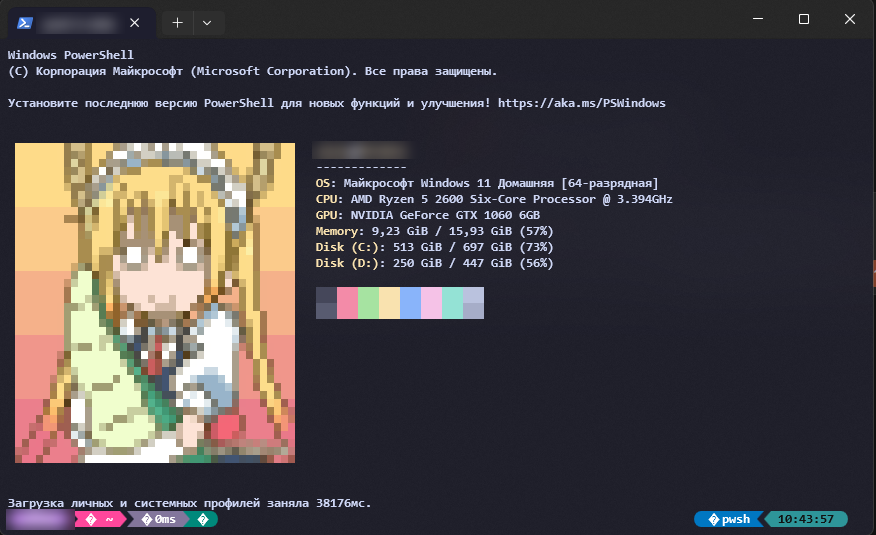
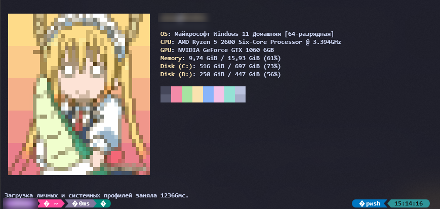

# 🐉 Мои конфиги терминала (Windows 11)

Красивый терминал на Windows: **PowerShell + Oh My Posh + Terminal-Icons + fastfetch/winfetch** с пиксельной Тору из «Dragon Maid» 🧡





> Арт: by **datwe**

---

## 📁 Что внутри

```
.
├── powershell/
│   ├── Microsoft.PowerShell_profile.ps1   # профиль: Oh My Posh + Terminal-Icons
│   └── profile.ps1                        # расширенный профиль: UTF-8, тема atomic, winfetch
├── fastfetch/
│   ├── config.jsonc                       # модули: title, OS, CPU, board, memory, disk, colors
│   ├── config-with-logo.jsonc             # вариант конфига с логотипом из файла
│   ├── tohru.png                          # исходная картинка
│   └── tohru.sixel                        # она же в формате sixel (для вывода в терминале)
└── screenshots/                           # скриншоты для README
```

---

## ⚙️ Что нужно установить

Открой PowerShell и выполни:

```powershell
winget install JanDeDobbeleer.OhMyPosh
winget install Fastfetch-cli.Fastfetch
winget install Git.Git
Install-Module -Name Terminal-Icons -Repository PSGallery
```

Также нужен шрифт **Nerd Font** (например, *CaskaydiaCove Nerd Font* или *MesloLGS NF*): без него в строке приглашения будут квадратики `�`.
Скачать: https://www.nerdfonts.com/ → после установки выбери его в настройках Windows Terminal (Профили → Внешний вид → Шрифт).

> Sixel-картинки работают в **Windows Terminal 1.22+**.

---

## 🚀 Установка

### 1. Скачать репозиторий

```powershell
git clone https://github.com/alalal68-wq/tohru-terminal.git
cd tohru-terminal
```

### 2. ✏️ Добавить свой ник

В файлах `powershell/profile.ps1` и `fastfetch/config-with-logo.jsonc` найди слово **`YOUR_USERNAME`** и **замени на имя своей папки пользователя Windows** (то, что в пути `C:\Users\...`).

Узнать его можно командой:

```powershell
$env:USERNAME
```

### 3. Скопировать файлы

```powershell
# Профиль PowerShell
New-Item -ItemType Directory -Force (Split-Path $PROFILE) | Out-Null
Copy-Item .\powershell\Microsoft.PowerShell_profile.ps1 $PROFILE -Force

# fastfetch
New-Item -ItemType Directory -Force "$env:USERPROFILE\.config\fastfetch" | Out-Null
Copy-Item .\fastfetch\* "$env:USERPROFILE\.config\fastfetch\" -Force
```

### 4. Тема Oh My Posh

В профиле используется файл темы `config.omp.json` (или `atomic.omp.json`) в папке `%LOCALAPPDATA%\oh-my-posh\`.
Скачать готовую тему:

```powershell
oh-my-posh config export --output "$env:LOCALAPPDATA\oh-my-posh\config.omp.json"
```

Или выбери любую из https://ohmyposh.dev/docs/themes

### 5. Перезапустить терминал

Закрой и открой Windows Terminal. Готово! ✨

Запустить fastfetch вручную:

```powershell
fastfetch
```

---

## 🖼 Как поменять картинку

1. Положи свою картинку в `fastfetch/`.
2. Преобразуй в sixel, например через [chafa](https://hpjansson.org/chafa/) (`winget install hpjansson.Chafa`):
   ```powershell
   chafa -f sixel -s 30x15 my-image.png > my-image.sixel
   ```
3. Укажи путь к ней в `config.jsonc` в разделе `logo`.

---

## 💬 Мои соцсети

[](https://www.youtube.com/@python-v7)
[](https://www.donationalerts.com/r/bugcrack1)

Если конфиги пригодились, поставь ⭐ репозиторию и загляни на канал.

---

## 🙏 Благодарности

- [Oh My Posh](https://ohmyposh.dev/)
- [fastfetch](https://github.com/fastfetch-cli/fastfetch)
- [Terminal-Icons](https://github.com/devblackops/Terminal-Icons)
- Арт Тору: **datwe**
